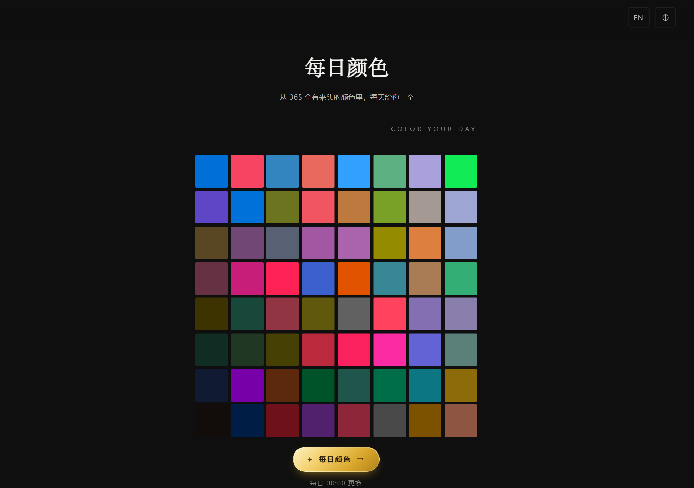
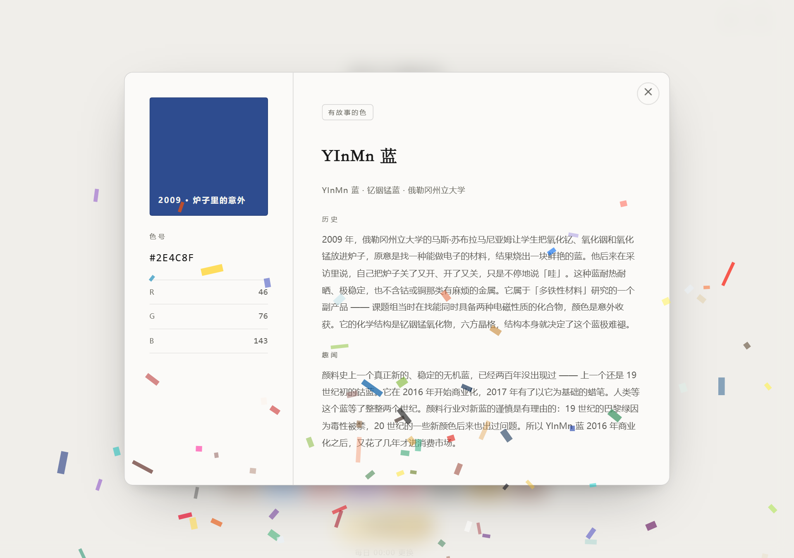

# Color Your Day · 每日颜色

**English**: A tiny, dependency-free "color of the day" widget — an 8×8 mosaic drawn from a curated
library of 365 colors (historical pigments, traditional Chinese colors, named brand colors, and
colors with a story). Pure HTML/CSS/JS, no build step, no CDN, no framework.

每天从 365 个有来头的颜色里给你一个：点开方阵下方的按钮，看这个颜色的色号、RGB
和它背后的历史与趣闻。从个人摄影站里抽出来做成的独立组件。




## 它是怎么工作的

- **「今天」由日期算出来，不靠随机数** —— 按「日历日」对 365 取模（用 `Date.UTC`，
  夏令时切换那天也不会漏天或重复）。同一天永远是同一个颜色，跨过 00:00 才换。
- **方阵不剧透** —— 它不铺今天的颜色，而是每次载入从库里**整轮洗牌**抽 64 个
  （库 ≥ 64 保证一格一色），按「相对亮度」沿一条对角线从暗到亮排开。
  想知道今天是什么，得点那颗金色按钮。
- **明暗是算出来的，不是画出来的** —— 每格保留抽到颜色的色相与饱和度，只反解明度
  （以相对亮度 Y 定标，二分求解）。所以整片方阵是「一排不同的颜色沿一条亮度坡排开」，
  而不是一片同色的深浅。
- **方向跟着主题走** —— 切到浅色主题，整条亮度轴镜像成从另一角扫来。
  切换用 View Transitions 做整页交叉淡化，方阵等淡化收尾后从新的角重新铺一遍。
- **磁贴手感** —— 光标滑过时格子按距离被托起来（位移/放大/投影全由一个 CSS 变量驱动），
  触屏与 `prefers-reduced-motion` 下自动不装。
- **点按钮翻开详情** —— 左栏色块 + 色号 + RGB，右栏历史与趣闻；
  焦点移入弹窗、Tab 循环、Esc 关闭并归还焦点。附带一场生日礼花式的粒子庆祝。

双语（中文 / English），右上角切换；主题选择与语言都会记住。

## 运行

零依赖、零构建。任何一个静态服务器指到仓库根即可：

```bash
python -m http.server 8000
# 打开 http://localhost:8000
```

（直接双击 `index.html` 也能跑。）

## 目录

```
index.html                 页面（结构：方阵 + 详情弹窗）
assets/css/style.css       样式（主题变量 + 方阵 + 弹窗 + 降级守卫）
assets/js/app.js           逻辑（配色算法 / 抽色 / 磁贴 / 弹窗 / 礼花）
assets/js/colors_data.js   ⚠ 编译产物，不要手改 —— 由 data/*.json 编译而来
data/*.json                颜色库源数据（4 个分类文件，365 条）
data/README.md             数据格式说明 + 加颜色的流程
tools/build_colors.py      编译器（带数据体检：hex 格式 / id 与中文名查重 / 字段名白名单）
docs/                      README 用的截图
```

## 改颜色 / 加颜色

改 `data/` 里对应分类的 `items`，然后：

```bash
python tools/build_colors.py
```

字段格式、查重规则与「库 ≥ 64」「库 ≥ 365」两条约束见 [data/README.md](data/README.md)。

## 从摄影站里抽出来时改了什么

- **数据两层并成一层**：摄影站为了保首屏体积，把色库拆成「hex 索引层 + 按需全文层」；
  这里只有一个页面、没有首屏预算要守，所以 `window.QB_COLORS` 直接就是全文，
  `cdLoadFull()` 退化成直接 resolve（调用点一行未改）。
- **配色公式、抽色算法、磁贴、弹窗、礼花全部原样保留**，包括几条有真实翻车记录的契约：
  「今天」的下标一路带到底（库里有两条颜色共用 `#0ABAB5`，按 hex 反查必错位）、
  切语言/切主题重绘不得重抽、`animation-fill-mode` 改动 `scale` 而不是 `transform`。
- **字体不打包**：摄影站用自托管的思源宋体子集；这里落到系统宋体栈，零字节也免去
  字体授权包袱。想要一致观感，把子集 woff2 放进 `assets/fonts/` 补一条 `@font-face` 即可。

## 许可

[AGPL-3.0](LICENSE)。数据（`data/`）与代码同许可。
颜色名与色号是事实信息；各条目的「历史 / 趣闻」文案为本仓库撰写。
